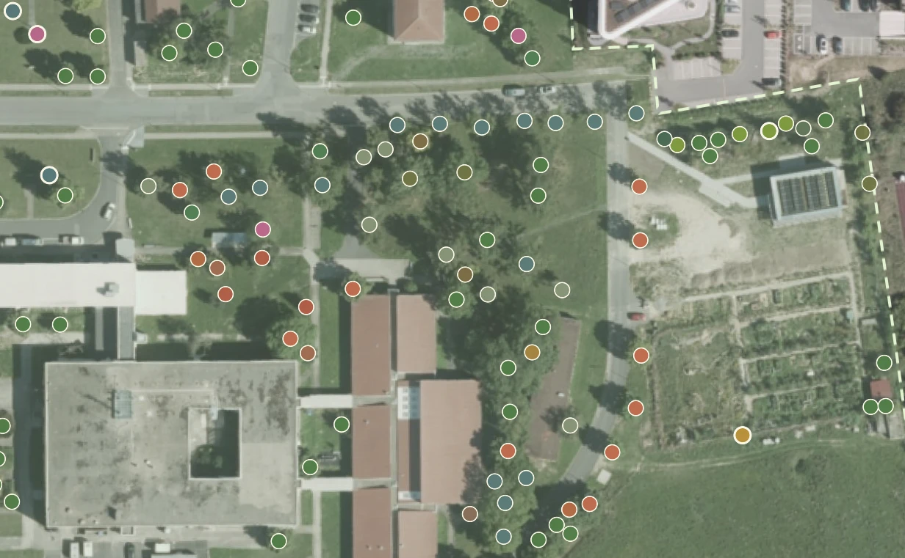
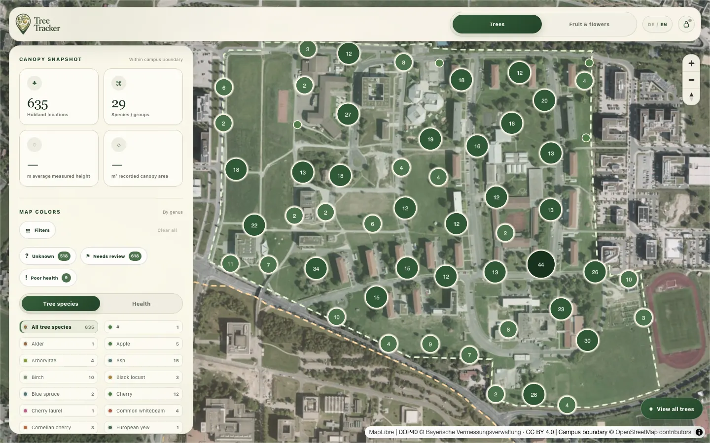
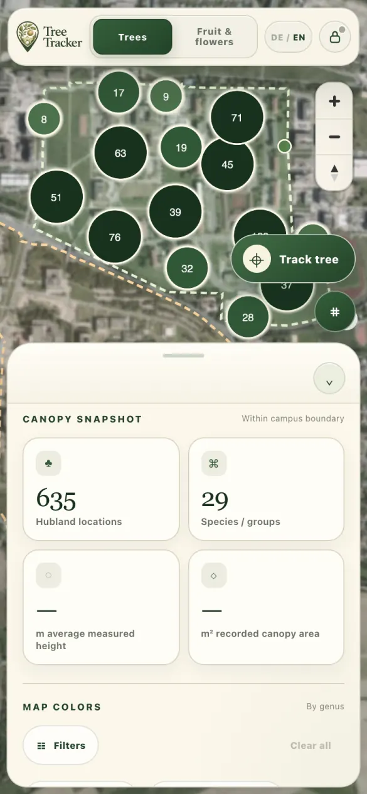
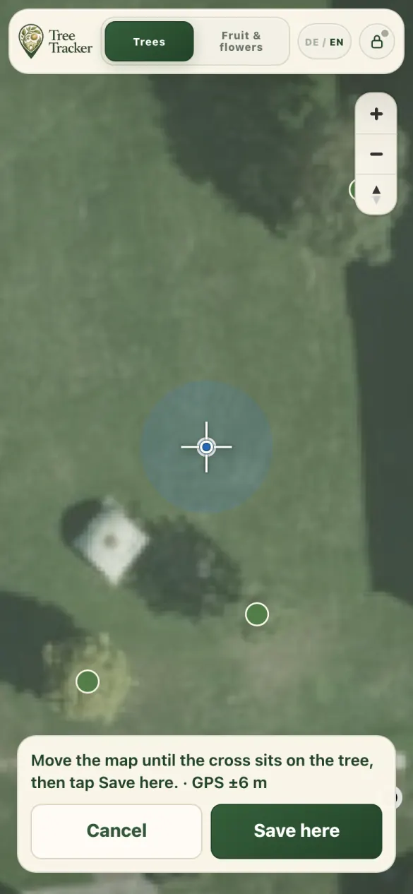
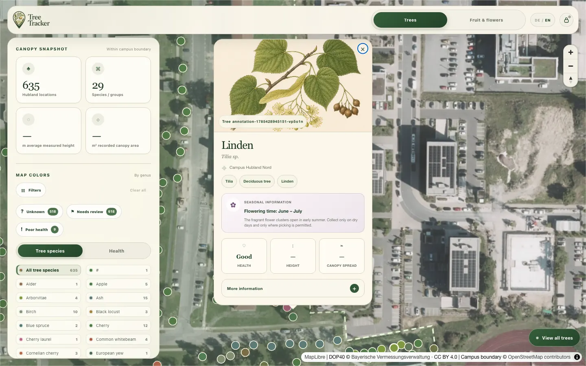
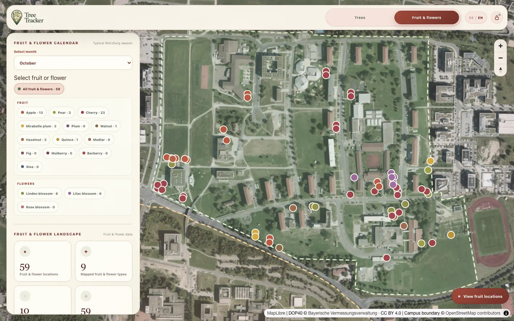
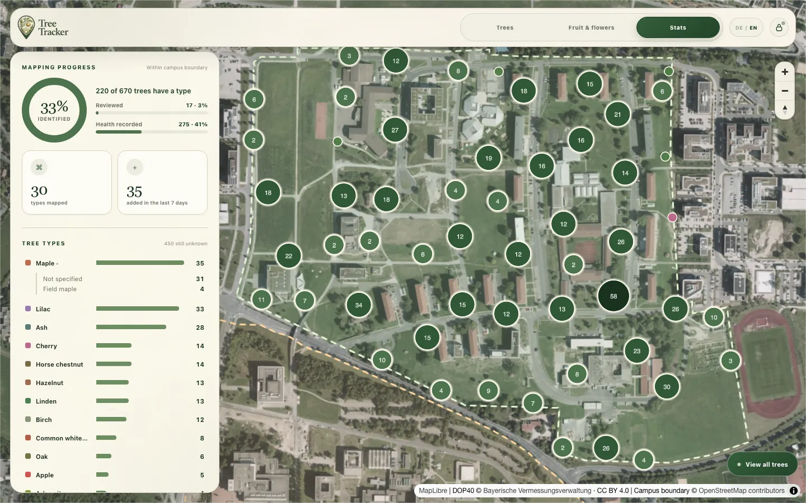

# Tree Tracker — Campus Hubland

A map for recording the trees of Campus Hubland Nord in Würzburg: walk around
with your phone to map trees, then review and edit them on your laptop. Both stay
in sync through Firebase.

**Live:** https://juliawenkmann.github.io/hubland-canopy/



## Features

- **Field mapping on the phone.** *Track tree* follows your GPS position (with
  live accuracy) and drops a cross in the middle of the map; nudge it onto the
  trunk in the aerial photo and tap *Save here*. *Place tree* does the same
  without GPS.
- **Works offline.** The app opens without signal, keeps what you map and
  uploads it once you're back online.
- **Your trees everywhere.** Sign in once per device (lock in the top bar) and
  every tree lives in the cloud.
- **Tree types with subtypes** (e.g. Ahorn → Spitz-, Berg-, Feld-Ahorn); names
  you type yourself join the matching type.
- **Colour by species or health**, with quick filters for trees of **unknown
  type**, trees that **need review** and trees in **poor health**.
- **Statistics**: how many trees are identified and reviewed, tree types with
  their subtypes, and ring charts of growth form and health.
- **Botanical plates** in each tree's popup, and a **Fruit & flowers** mode with
  a seasonal calendar.
- English and German, installable as a home-screen app and as a Mac app.

| Laptop | Phone | Placing a tree |
| --- | --- | --- |
|  |  |  |

| Tree details | Fruit & flowers | Statistics |
| --- | --- | --- |
|  |  |  |

## Using it

1. Open the live URL and tap the **lock** in the top bar to sign in (or *Create
   account* the first time). Only the editor account in
   `firebase/firestore.rules` can add or edit trees; everyone else sees a
   read-only map.
2. On the phone, add it to the home screen so it opens full screen:
   - iPhone: Safari → Share → *Add to Home Screen*. The home-screen app has its
     own storage, so sign in once more inside it.
   - Android: Chrome menu → *Install app*.
3. **Import / Export GeoJSON** sit under *Your trees* in the dashboard.

### Mac app

```bash
./scripts/install-mac-app.sh
```

Installs **Tree Tracker** in `~/Applications` and the Dock. Clicking it starts a
small local server (`scripts/serve.mjs`, port 27190, needs Node.js) and opens
the app in your browser. Nothing starts at login. Re-run the script after
changing the code.

## Project layout

```
index.html              page markup
css/app.css             styles
js/
  data/                 tree types and subtypes, fruit locations, UI text (EN/DE), map style
  state.js              shared app state and storage keys
  storage.js            this device's copy of the trees and the upload outbox
  cloud-sync.js         Firestore sync through the outbox
  account.js            lock button and sign-in panel
  field-capture.js      GPS / cross-hair tree placement
  map-layers.js         map sources and layers
  map-view.js           colours, legend, what the map shows
  inventory.js          campus scoping and filter values
  filters.js            filter panel and quick filters
  dashboard.js          dashboard panel, Trees tab charts
  stats.js              Statistics tab
  fruit.js              Fruit & flowers mode
  popup.js              tree popups and botanical plates
  annotation-editor.js  the edit form
  annotations.js        adding, editing, exporting trees
  i18n.js               language switching
  main.js               start-up and event wiring (loads last)
  firebase-config.js    public Firebase web config
assets/                 logo, app icons, botanical plates
docs/screenshots/       images used in this README
scripts/                Mac app installer and its local server
sw.js                   service worker (offline support)
manifest.webmanifest    home-screen install metadata
firebase/               Firestore security rules and indexes
```

No build step: the scripts are plain `<script defer>` files that share globals
and load in the order listed in `index.html`.

## Development

```bash
python3 -m http.server 8000
```

Then open http://localhost:8000. Format code with
`npx prettier --write js css sw.js scripts/serve.mjs`.

To test sync without touching real data, start the Firebase emulators and open
http://localhost:8000/?firebase-emulator=1:

```bash
npx firebase-tools emulators:start --only auth,firestore --project tree-tracker-rules-test
```

In the emulator, *Create account* with the editor email from
`firebase/firestore.rules` to be allowed to edit.

## Deploying

- **App:** GitHub Pages serves the `main` branch, so pushing to `main` publishes it.
- **Firestore rules:** `npx firebase-tools deploy --only firestore:rules`

## Data sources

- Campus boundary and part of the tree baseline: © OpenStreetMap contributors (ODbL 1.0)
- Fruit locations: [mundraub.org](https://mundraub.org)
- Aerial imagery: DOP40 © Bayerische Vermessungsverwaltung (CC BY 4.0)
- Plates for Lebensbaum, Blasenbaum, Hainbuche, Weißdorn, Lärche, Japanischer
  Schnurbaum, Amberbaum, Esskastanie, Judasbaum, Magnolie, Trompetenbaum,
  Tulpenbaum, Wacholder, Weide, Zürgelbaum and Tanne: Pierre-Joseph Redouté,
  *Traité des arbres et arbustes* (1800–1819), public domain; scans by the New
  York Public Library via Wikimedia Commons
- Mammutbaum plate: *Curtis's Botanical Magazine*, Tab. 4778 (1854), public
  domain, via the Biodiversity Heritage Library and Wikimedia Commons
- Douglasie plate: watercolour by Mary Vaux Walcott, public domain, via
  Wikimedia Commons
